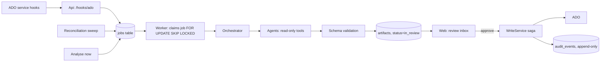

# Architecture

## Projects

```
src/backend/
  QaSecondBrain.sln
  QaSecondBrain.Api/            ASP.NET Core: controllers, auth, SSE, webhook intake
  QaSecondBrain.Worker/         Hosted service: job runner, reconciliation sweep, schedulers
  QaSecondBrain.Core/           Domain: entities, artifact types, interfaces, policies (no I/O)
  QaSecondBrain.Agents/         Agent runtime: skill loader, prompts, orchestrators, schema validation
  QaSecondBrain.Infrastructure/ EF Core (Npgsql), ADO client, LLM clients, redaction, write service, search
  tests/
    QaSecondBrain.UnitTests/
    QaSecondBrain.IntegrationTests/   Testcontainers Postgres + WireMock ADO + FakeLlmClient
src/web/                        Vite + React + TypeScript + MUI + React Query
skills/                         Pinned copies of marketplace skills (SKILL.md + references), with skills.lock.json
deploy/docker-compose.yml       Postgres 16 for local dev
```

## Runtime flow



## Key decisions

- **Job queue**: a Postgres `jobs` table claimed with `FOR UPDATE SKIP LOCKED`. Idempotency key = (team_id, work_item_id, event_type, revision). Jobs for the same work item run in order.
- **LLM**: `ILlmClient` with two implementations, chosen by config `Llm:Provider`:
  - `ClaudeCli` (**default for local runs until an API key exists**): runs `claude -p --output-format json --model <model>` as a child process, prompt on stdin, no tools allowed (`--allowedTools ""`), with a timeout and cancellation. Tokens and `total_cost_usd` are read from the JSON result.
  - `AnthropicApi`: used when `Llm:Provider=AnthropicApi` and a key is configured.
  Model and effort per agent come from team settings. Every call writes an `llm_calls` row (provider, tokens, cost, duration, agent, run). The CLI provider is for local development only; hosted environments must use the API.
- **Agents** are defined by skills in `skills/` at the version in `skills.lock.json`. Each skill declares the tools it needs in `tools.json`; the loader fails if a tool is missing.
- **Tools available to agents** (read-only): `ado.get_work_item`, `ado.list_comments`, `ado.get_revisions`, `ado.wiql`, `ado.get_pr`, `ado.get_pr_diff`, `ado.get_file`, `ado.code_search`, `ado.list_test_cases`, `kb.search`, `kb.get_entry`, `history.similar_defects`.
- **Writes**: `WriteService` takes an approved artifact and its dry-run write plan, executes each step with an ADO revision check, records step status, retries, and compensates where possible.
- **Auth**: Entra ID (OIDC) for users. Roles per team: qa, lead, dev, viewer, admin.
- **Tenancy**: every table has `team_id`; Postgres RLS uses `app.team_id` set per request or job.
- **Secrets**: environment variables locally, Key Vault in hosted environments. ADO credentials are per team.
- **Live progress**: Server-Sent Events from `EventBus`.
- **Search**: Postgres full-text first. pgvector is added in S7 only if the eval shows retrieval misses.
